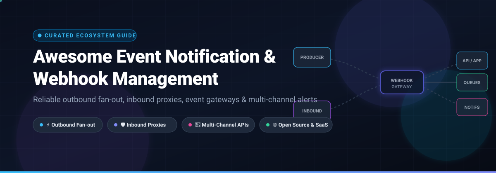

# 🚀 Awesome Event Notification & Webhook Management

  

  
  
  
  
  
  

---

## 🌟 Top Event Notification & Webhook Management Ecosystem

> 🎯 **A Curated List of SaaS Platforms & Open-Source Projects**  
> *Focused on Outbound Webhook Delivery, Inbound Proxying, Event Routing, Dead-Letter Queues & Multi-Channel Notifications.*  
> 📅 **Last updated: March 2026**

This repository tracks notable **SaaS platforms** and **open-source tools** engineered for **Event Notification & Webhook Management**. Modern applications rely on these systems for reliable event deliveries—ranging from outbound webhook fan-out with automated retries, rate-limiting, and cryptographic HMAC signing to inbound webhook proxies that inspect, verify, buffer, and route traffic to internal services and private VPC networks.

Key solutions featured here include **Novu**, **Apprise**, **Gotify**, **Adnanh Webhook**, **Webhook.site**, **Svix**, **Convoy**, **Inngest**, **Hook0**, **Hookdeck Outpost**, **Standard Webhooks**, **Courier**, and **Zapier**.

---

## 📑 Table of Contents

- [📊 Sector Overview & Market Dynamics](#-sector-overview--market-dynamics)
- [☁️ SaaS & Hosted Platforms](#️-saashosted-platforms)
- [💻 Open-Source GitHub Projects](#-open-source-github-projects)
- [🤝 How to Contribute](#-how-to-contribute)
- [☕ Support](#-support)
- [📈 Star History](#-star-history)
- [⚠️ Disclaimer](#️-disclaimer)

---

## 📊 Sector Overview & Market Dynamics

The global market for **Event-Driven Architecture (EDA) and Integration Platforms** is estimated between **$3.7B and $5.8B** (growing at an ~18–21% CAGR) as software teams modernize from legacy request-response patterns toward decoupled asynchronous microservices and agentic real-time pipelines. The sector remains **highly fragmented** across specialized outbound delivery engines, resilient inbound proxies, unified notification APIs, and general-purpose iPaaS orchestrators—with no winner-take-all monopoly, leaving developers free to combine tailored SaaS providers with high-performance self-hosted open-source software.

---

## ☁️ SaaS & Hosted Platforms

| Product | Company Scale (Valuation / Revenue) | Description | Pricing (Starting) | Free Tier / Trial Limits |
|:---|:---|:---|:---|:---|
| **[Zapier Webhooks](https://zapier.com/)** | **$5.0B** valuation / ~$310M+ ARR | ⚡ No-code webhook triggers and actions within Zapier. Receives inbound webhooks and sends outbound requests as part of multi-step automated Zaps. | Professional starts at **$19.99/month** (billed annually) or **$29.99/month** (monthly) for 750 tasks | **Free forever**: 100 tasks/month, limited to 2-step Zaps (1 trigger, 1 action), 15-minute polling interval |
| **[Inngest](https://www.inngest.com/)** | **~$105M - $175M** est. valuation ($34M total funding) | 🔄 **Workflow orchestration for event-driven automations.** Durable step functions with retries, flow control (concurrency, throttling, debouncing), and event replay. | Pro starts at **$99/month** for 1,000,000 executions and higher concurrency | **Free forever**: 50,000 executions/month, 5 concurrent steps, 5 seats, 24-hr trace history (executions pause when limit reached) |
| **[Pipedream](https://pipedream.com/)** | **~$80M** valuation (Acquired by Workday; $20M+ funding) | 🧩 **Integration platform for event-driven workflows.** Connects 3,000+ APIs with pre-built components and custom Node.js/Python/Go/Bash code. | Startup starts at **$99/month** (billed annually) or **$150/month** (monthly) for 10,000 credits & up to 100 users | **Free forever (Development/Test Plan)**: Daily credit allowance (~333 credits/day, 1 credit = 30s compute), 750s builder test runtime/day, development/testing only |
| **[Courier](https://www.courier.com/)** | **~$50M - $100M+** est. valuation ($57M+ funding) | 📣 **Multi-channel notification API.** Sends notifications across email, SMS, push, and chat with a unified API, visual workflow studio, and logs. | Business starts at **$0.005 per send** (pay-as-you-go after free allowance or with billing added) | **Free forever (Developer Plan)**: 10,000 sends/month across all channels with full API, template, and SDK access |
| **[Svix](https://www.svix.com/)** | **~$25M - $50M** est. valuation ($13M+ funding) | ⚓ **The webhook service standard.** Hosted webhook delivery with a Rust-based open-source server as its foundation. Standard Webhooks originator (HMAC-SHA256). 8 retries over ~28 hours, payload replay, and rate limiting per endpoint. | Basic starts at **$20/month** (includes production 99.9% uptime SLA and pay-as-you-go scaling) | **Free forever**: 50,000 messages/month, 50 messages/second rate limit, 7-day payload retention |
| **[Hookdeck](https://hookdeck.com/)** | **~$10M - $20M** est. valuation ($2.7M funding, ~$880K ARR) | 🛡️ **Inbound webhook proxy and event gateway.** Receives webhooks from providers (Stripe, GitHub, Shopify), buffers them, and forwards to your application with retries and observability. | Team starts at **$39/month** (includes 7-day retention and unlimited team users) | **Free forever (Developer Plan)**: 10,000 events/month, 3-day event history retention, 1 user seat |

---

## 💻 Open-Source GitHub Projects

*Curated active repositories for self-hosted webhook delivery, notification gateways, and event infrastructure, sorted descending by GitHub stargazers count.*

| Project | GitHub_Stars | Description | License |
|:---|:---:|:---|:---:|
| **[Novu](https://github.com/novuhq/novu)** |  | 🔔 **Open-source notification infrastructure for transactional & multi-channel messaging.** Connects email, SMS, push, in-app inbox, chat, and webhooks with multi-step workflows, visual editor, and provider integrations. | MIT / AGPL-3.0 |
| **[Apprise](https://github.com/caronc/apprise)** |  | 📢 **Push notifications that work with almost every service.** Single Python library and CLI gateway to deliver instant notifications and webhooks to 90+ platforms (Discord, Slack, Telegram, Twilio, Matrix, Email, MQTT, etc.). | BSD-3-Clause |
| **[Gotify Server](https://github.com/gotify/server)** |  | 📨 **Simple, self-hosted, real-time push notification server.** Lightweight Go application with WebSocket streaming, Android client, REST API, priority queues, and instant tokenized webhook triggers. | MIT |
| **[Webhook (Adnanh)](https://github.com/adnanh/webhook)** |  | ⚡ **Lightweight incoming webhook server in Go.** Configures HTTP webhook endpoints to parse incoming payloads and trigger customizable shell commands, CI/CD scripts, or deployment pipelines. | MIT |
| **[Webhook.site](https://github.com/webhooksite/webhook.site)** |  | ⚓ **Inspect, debug, and test incoming HTTP webhooks instantly.** Open-source self-hostable Laravel application that captures HTTP requests and displays payloads, headers, and query parameters in real time. | MIT |
| **[Inngest OSS](https://github.com/inngest/inngest)** |  | 🔄 **Durable workflow orchestration engine for event-driven applications.** Self-hostable single binary with SQLite or PostgreSQL backing. Flow control, rate-limiting, step debounce, and execution traces. | Apache-2.0 |
| **[Svix Server](https://github.com/svix/svix-webhooks)** |  | 🦀 **Enterprise-ready webhook sending service written in Rust.** Reliable outbound delivery with exponential retries, cryptographic HMAC signatures, payload replay, and customer-facing portal. | MIT / Apache-2.0 |
| **[Convoy](https://github.com/frain-dev/convoy)** |  | 🛡️ **Cloud-native webhooks gateway in Go.** Bi-directional edge gateway supporting both outbound fan-out and inbound webhook routing, consumer iframe debugging dashboards, rate limiting, and circuit breaking. | Elastic License 2.0 |
| **[Standard Webhooks](https://github.com/standard-webhooks/standard-webhooks)** |  | 📜 **Strict, unified specification and tooling for webhook signatures and headers.** Defines standardized HMAC-SHA256 headers (`webhook-id`, `webhook-timestamp`, `webhook-signature`) with multi-language validation libraries. | Apache-2.0 / MIT |
| **[Hook0](https://github.com/hook0/hook0)** |  | 🎯 **Full-featured open-source outbound webhook management platform.** Multi-tenant label filtering, dead-letter queues (DLQ), HMAC signatures, retry policies, and official SDKs for 12+ programming languages. | SSPL-1.0 |
| **[Outpost (Hookdeck)](https://github.com/hookdeck/outpost)** |  | 🌐 **Production-ready self-hosted outbound webhook & event destinations engine.** Delivers events reliably to webhooks and 10+ cloud destinations (AWS SQS, EventBridge, GCP Pub/Sub, Kafka, RabbitMQ) with customer self-service portals. | Apache-2.0 |
| **[good-webhooks](https://github.com/pplytas/good-webhooks)** |  | 📦 **Transactional outbox-pattern webhook delivery library.** Publishes webhooks atomically within your application database transactions in PostgreSQL without losing events during service outages. | MIT |
| **[Hookdash](https://github.com/me-npm/hookdash)** |  | ⚡ **Zero-config self-hosted webhook gateway powered purely by SQLite.** Run instantly via `npx hookdash start`, verifying signatures from Stripe, GitHub, Twilio, and Shopify with automatic retries and a dark-mode dashboard. | MIT |

---

## 🤝 How to Contribute

Contributions are warmly encouraged! Here is how you can help expand this community resource:

1. 🍴 **Fork the repository** on GitHub.
2. 🌿 **Create a branch** for your updates (`git checkout -b feature/new-webhook-tool`).
3. 📝 **Add or update the project** in `README.md` keeping formatting clean, factual, and linking directly to primary repos/documentation.
4. 🧪 **Check link validity** and ensure correct alphabetical or star sorting.
5. 🚀 **Submit a Pull Request** with a brief summary of what you added and why it benefits developers!

---

## ☕ Support

If you find this ecosystem guide helpful for your projects, architecture designs, or dev setup:

- ⭐ **Star this repository** to help others discover it!
- 🍴 **Fork and share** with teammates building distributed, event-driven systems.
- 💖 **Sponsor the maintainer** via the [GitHub Sponsor Dashboard](https://github.com/sponsors/ishandutta2007) to support continuous maintenance and open-source contributions.

---

## 📈 Star History

---

## ⚠️ Disclaimer

- This curated list is **community-maintained** for educational and architectural reference—inclusion does not imply a formal endorsement.
- Webhook endpoints and event payloads often transmit sensitive user data. Always verify incoming payloads with cryptographic HMAC signatures (such as Standard Webhooks), enforce HTTPS, implement exponential backoff with jitter, and design downstream ingestion handlers to be strictly **idempotent**.
- **Licensing & Architecture Considerations**: Review open-source licenses carefully for your use case (e.g., SSPL vs. MIT vs. Apache-2.0 vs. Elastic License). Determine whether your infrastructure demands an outbound fan-out engine (Hook0, Outpost, Svix), an inbound gateway/proxy (Hookdeck, Hookdash, Webhook.site), or a unified multi-channel communication layer (Novu, Apprise, Gotify).

---

  <b>Built with ❤️ for developers, platform engineers, and teams architecting event-driven infrastructure.</b>

